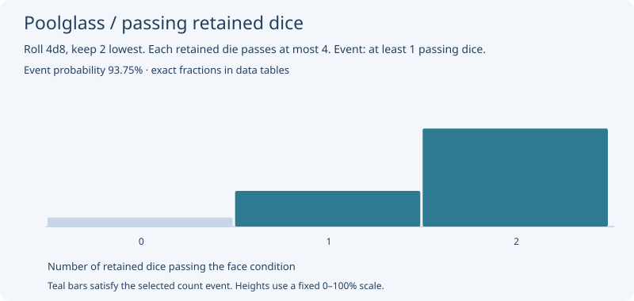

# Poolglass

Keep the dice. Count the successes.

[Open Poolglass](https://poolglass-chi.vercel.app)

Poolglass calculates how many **retained dice individually pass a face target**. Choose highest or lowest retention, inspect the full success-count distribution, and compare the selected event with rolling only the kept dice.

- **Exact ordered-outcome counts:** BigInt arithmetic and reduced fractions throughout.
- **Four face conditions:** below, at most, at least, or above a target.
- **Three count events:** at least, exactly, or at most a chosen number of passing retained dice.
- **A clear baseline:** the same face condition and count event, rolling only the kept dice.
- **Complete target sweep:** recalculate every target from 0 through faces + 1.
- **Portable studies:** project JSON, full exact receipts, two CSV tables, HTML report and SVG distribution.
- **Local processing:** no accounts, uploads, analytics, remote APIs, browser storage or runtime dependencies.

## Output preview



This is an actual generated distribution chart, **not an application screenshot**. Native browser visual, screen-reader, operating-system download and print checks remain unverified; a real workspace screenshot is pending.

## Run locally

Requires Node.js 22 or 24, npm, and a modern browser with BigInt and `String.isWellFormed`.

```sh
npm ci --ignore-scripts --no-audit --no-fund
npm test
npm run build
npm run dev
```

Open [http://127.0.0.1:4224](http://127.0.0.1:4224). The static build is in `dist/`. No backend or environment variables are needed. JSDOM is a pinned development-only test dependency; the build uses Node's standard library.

## Define a study

1. Set the number of dice rolled and the number of faces on each die.
2. Choose how many dice to keep and whether to keep the highest or lowest face values.
3. Define a passing **individual die face**: below, at most, at least, or above the face target.
4. Choose a count event, such as **at least one passing retained die**.
5. Calculate, inspect the distribution and target sweep, then save a project before closing.

All dice are identical, independent and fair, numbered 1 through the face count. Retention happens by face value; the passing condition is evaluated on each retained die. Ties at a retention boundary do not affect success counts because equal faces have the same passing status.

The **face target** and the **required passing-dice count** are different inputs. For example, “at most 4” defines which faces pass; “at least 1” defines how many of the kept dice must pass.

Projects retain settings and notes. Edits disable downloads until a successful recalculation. Failed imports keep existing work; later edits or reset discard a pending import result. Nothing is automatically saved. Closing or refreshing loses unsaved changes.

## Worked example

Roll **4d8**, keep the **2 lowest**, and let each retained die pass on **4 or less**.

There are `8^4 = 4,096` equally likely ordered outcomes.

| Passing retained dice | Ordered outcomes | Exact probability |
| --- | --- | --- |
| 0 | 256 | 1/16 |
| 1 | 1,024 | 1/4 |
| 2 | 2,816 | 11/16 |

The chance of **at least one** passing retained die is `15/16 = 93.75%`.

The baseline rolls only **2d8**, retains both, and uses the same event. Its chance is `3/4 = 75%`. The difference is `3/16` in probability, or **+18.75 percentage points**. This is not an 18.75% relative increase.

Keeping the **2 highest** with the same roll-under condition instead gives `5/16 = 31.25%` for at least one passing retained die. Retention direction matters.

## Exact model

Let:

- `N` be rolled dice, `K` kept dice, `S` faces, and `A` passing faces on one die.
- `X` be the number of passing dice in the original pool.
- `Y` be the number of passing dice after retention.

The ordered-outcome weight for `X = x` is:

```text
choose(N, x) × A^x × (S − A)^(N − x)
```

The total is `S^N`. This is a binomial model, with integer face-count weights rather than floating-point probability arithmetic.

For a low-face passing condition and lowest retention, or a high-face condition and highest retention:

```text
Y = min(X, K)
```

For retention from the opposite end:

```text
Y = max(0, X − (N − K))
```

Weights with the same retained-success count are combined. The selected count event sums the appropriate bins. The baseline uses `N = K`, so every rolled die is retained.

[Binomial distribution reference — NIST](https://www.itl.nist.gov/div898/handbook/eda/section3/eda366i.htm)

## Precision and checks

Outcome counts, fractions, means, event probabilities and baseline differences use BigInt arithmetic. JSON exports store BigInt values as **decimal strings**, preserving counts beyond JavaScript's safe integer range.

Percentages are rounded half-up to six decimal places. A positive probability too small to display is shown as `<0.000001%`; a noncertain probability rounding to 100% is shown as `>99.999999%`. Percentage-point differences are also rounded; exact probability differences remain in the receipt.

Charts use a fixed 0–100% vertical scale with heights quantized to one thousandth of a pixel. Tiny probabilities can have no visible bar. Exact values are in the data tables and exports; color is supplemented by textual event labels in the table.

Runtime conservation checks confirm nonnegative weights, bin counts and a total of `S^N`. They do **not** independently prove that each probability bin is correct. Separate tests enumerate raw faces, sort and retain dice, and count passing faces without using the formula.

## Limits

| Boundary | Limit |
| --- | --- |
| Dice rolled | Integer 1–100 |
| Faces per die | Integer 2–100 |
| Dice kept | Integer 1–dice rolled |
| Face target | Integer 0–faces + 1 |
| Required passing count | Integer 0–dice kept |
| Face conditions | Strict below / inclusive at most / inclusive at least / strict above |
| Count events | At least / exactly / at most |
| Title / notes | 100 / 4,000 UTF-16 units |
| Project import | 40,000 bytes; strict versioned schema |
| Visible tables | 20 rows per page; exports cover all rows |
| Maximum table lengths | 101 retained-success counts; 102 face targets |

Decimal, signed, padded and exponent-form numeric input strings are rejected. Literal unpaired UTF-16 surrogates are rejected in project text.

No sums of kept faces, equality-only face conditions, mixed or weighted dice, rerolls, explosions, modifiers, correlated rolls, game-specific critical rules, random rolling or optimal strategy analysis. The calculator does not verify physical die fairness or establish that a tabletop mechanic is balanced or enjoyable.

An event requiring **at least zero** passing dice is certain by definition. Impossible and certain face-target boundaries are included intentionally.

## Exports

| Download | Contains |
| --- | --- |
| Save project | Validated study settings and notes |
| Full JSON receipt | Exact distributions, all target rows, means, comparisons and conservation data |
| Distribution CSV | Every retained-success count with exact and cumulative outcome weights |
| Target sweep CSV | Every face target with pool/baseline exact fractions and differences |
| HTML study | Complete human-readable distribution, sweep, selected event and chart |
| Distribution SVG | Complete chart for the selected face target |

Pagination never limits exports. CSV contains known numeric results and fixed labels, without title or notes. Import long counts and fractions as **text columns** in spreadsheet applications to prevent numeric precision loss or date conversion. The JSON receipt preserves the original exact strings.

Projects and full reports contain notes; review before sharing. No sanitization or secret detection is performed.

## Verification and examples

`npm test` runs **26 automated checks**, including **2,640 independently enumerated retention/threshold cases** over small pools. Other checks cover factorial-based coefficient comparison, strict/inclusive boundaries, exact example probabilities, opposite-end retention, event semantics, baseline equality, target-sweep consistency, altered-mass rejection, maximum supported BigInt studies, exact round trips, complete exports, escaping and SVG geometry.

Simulated DOM checks cover the working study flow, retention/target changes, selected-target pagination, stale results, import races, project validation, reset, real Blob payloads, labels, captions, live status and keyboard-scroll chart markup. These do not establish native rendering, assistive-technology behavior or operating-system downloads.

CI runs tests and builds on Windows and Linux with Node 22 and 24.

`npm run example` regenerates six artifacts in [examples](examples/) from the generic worked example. No third-party game text or rules are included.

## Deploy to Vercel

Import this repository. Choose **Other**, Node **24.x**, build command `npm run build`, output directory `dist`, an empty install command, and the repository root as the project root. The build requires only Node's standard library.

No environment variables, database, paid integrations, purchased domains or paid APIs are needed. `vercel.json` supplies static build settings, content-type protection, no-referrer and CSP headers blocking application network connections.

MIT licensed.
